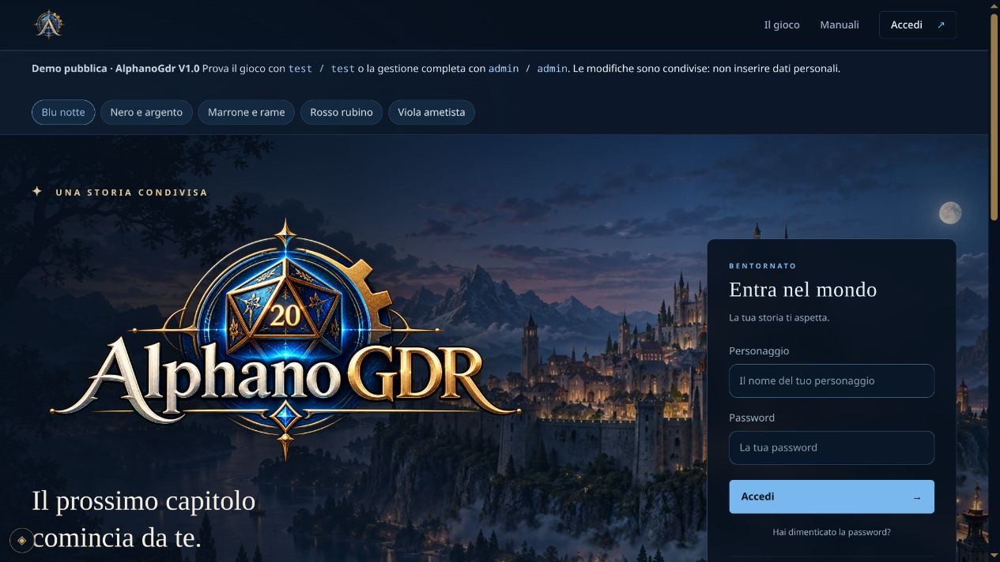
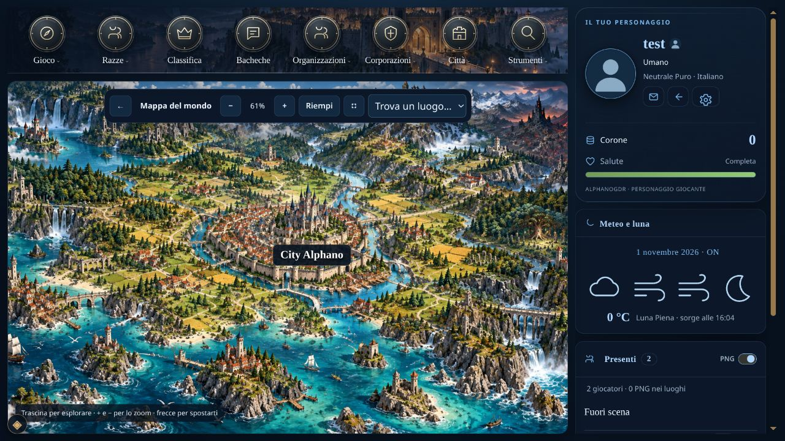
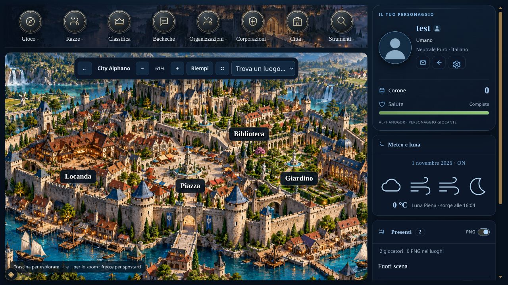

# AlphanoGdr V1.0

**Versione corrente: V1.0** · [Licenza GNU AGPL-3.0](LICENSE) · [Registro delle modifiche](CHANGELOG.md)

Motore open source per giochi di ruolo testuali via browser, scritto in PHP e MySQL. Comprende personaggi, chat, Master umani, forum, manuali, città, gruppi, economia, oggetti e strumenti di gestione. È pensato anche per hosting condivisi come **AlterVista Hosting / AlterSito**.

**Pacchetto della versione: `AlphanoGdr-V1.0-hosting.zip`.**

**Per installarlo basta il pacchetto hosting completo: scarica, scompatta, carica i file via FTP e apri il dominio oppure `index.php`. Se il gioco non è installato, si apre automaticamente la procedura guidata.** Le tabelle vengono create dal modulo: non devi importare SQL a mano né modificare un file di connessione.

Sul server non servono Composer, SSH, terminale, Node.js, Python, Docker o modelli di intelligenza artificiale. Occorrono uno spazio PHP compatibile e un database MySQL vuoto, già disponibili presso il provider. La configurazione del database e dell’amministratore si inserisce dal browser; non è richiesta una chiave di installazione.

[Pacchetti pronti in GitHub Actions](https://github.com/Aikanairo/AlphanoGdr/actions/workflows/verify.yml) · [Installazione dettagliata e AlterVista](docs/HOSTING.md) · [Personalizzazione grafica](docs/TEMPLATE.md) · [Immagini incluse](docs/DEFAULT-ART.md)

## Anteprima e demo

[Apri la demo pubblica](https://alfanew.altervista.org/?preview=1) · [Presentazione e screenshot](docs/ANNUNCIO-FORUM.md) · [Post pronto in BBCode](docs/ANNUNCIO-FORUM.bbcode.txt)



| Mappa del mondo | Sottomappa cittadina |
| --- | --- |
|  |  |

## Quale archivio scaricare

| Archivio | Contenuto e utilizzo |
| --- | --- |
| **`AlphanoGdr-hosting.zip`** | Pacchetto da installare: comprende già `vendor/`, tutte le dipendenze PHP, gli stili, gli script e le immagini predefinite. È quello da scompattare e caricare sull’hosting. |
| GitHub **Code → Download ZIP** | Include anche `vendor/`: estrai l’archivio e carica il contenuto della cartella principale sull’hosting. |
| `AlphanoGdr-source.zip` | Archivio per sviluppatori senza dipendenze; per installare senza Composer usa uno dei due pacchetti completi sopra. |

Per recuperare il pacchetto pronto dalla repository, apri **Actions → Verify and package**, scegli un’esecuzione riuscita e scarica l’artefatto **`AlphanoGdr-hosting-php-8.4`**. Può essere necessario accedere a GitHub. L’archivio dell’artefatto contiene `AlphanoGdr-hosting.zip`: estrai anche quest’ultimo finché vedi `index.php`, `install/` e `vendor/` affiancati. Se un pacchetto hosting è allegato a una release, puoi usare direttamente quello.

La distribuzione non contiene account o conversazioni reali, dump di un gioco esistente, lore o conversazioni di ambientazioni precedenti. Include 30 SVG neutri, 11 intestazioni panoramiche e, su richiesta dell’autore, 16 immagini degli slot equipaggiamento e 23 illustrazioni delle materie prime già impiegate sul suo sito. Le risorse autorizzate sono elencate nei manifest grafici.

## Installazione: FTP e browser

### 1. Prepara lo spazio

- **PHP 8.4 o successivo**. Le patch **8.4.27+** e **8.5.12+** sono consigliate per la sicurezza: una versione compatibile meno aggiornata mostra un avviso senza bloccare l’installazione.
- **MySQL 8.0+** oppure **MariaDB 10.6+**, con InnoDB, utf8mb4 e un database dedicato completamente vuoto.
- Estensioni PHP: `pdo_mysql`, `mbstring`, `fileinfo`, `openssl`, `curl`, `dom`, `xml`, `iconv` e sessioni. `gd` è consigliata per l’elaborazione delle immagini.
- Installa nella **radice del dominio o sottodominio**: per esempio `https://nomeaccount.altervista.org/`. Questa distribuzione non supporta l’installazione in una sottocartella come `/gioco/`.

### 2. Carica il contenuto del pacchetto

Scompatta `AlphanoGdr-hosting.zip` sul computer e trasferisci **tutti i file e tutte le cartelle**, compresi i file nascosti `.htaccess`. Usa il trasferimento binario o automatico del client FTP. Il solo caricamento dello ZIP via FTP non lo estrae sul server.

Nella cartella pubblica del dominio deve esserci questa struttura, senza una cartella contenitore aggiuntiva:

```text
radice del dominio/
├── index.php
├── .htaccess
├── install/
├── config/
├── private/
├── uploads/
├── vendor/
│   └── autoload.php
├── assets/
└── ... altre cartelle del pacchetto
```

`config/`, `private/` e `uploads/` devono essere scrivibili dal processo PHP; il modulo segnala eventuali problemi. Normalmente si parte da cartelle 755 e file 644, ma proprietario e permessi effettivi dipendono dal provider. Non impostare tutto a 777. Se è già presente un altro sito, fai prima un backup dei suoi file e database e usa uno spazio/database dedicato.

### 3. Apri il sito

Visita il dominio oppure `https://tuodominio/index.php`. Quando manca `config/local.php`, l’applicazione rimanda automaticamente a **`/install/`**, prima di connettersi al database di gioco.

Compila la prima pagina:

1. Host, porta, nome del database, utente e password MySQL; il socket Unix è facoltativo e sui normali hosting si lascia vuoto.
2. Nome e descrizione del gioco, nome della valuta, URL del dominio, nome del gestore e contatto di assistenza facoltativo.
3. Nome e password dell’**amministratore completo**, con conferma. Questo è l’account del gioco che creerai, distinto dall’account del provider o FTP.
4. Eventuali email; puoi lasciarle disabilitate e configurarle successivamente.
5. Leggi e conferma la licenza AGPL-3.0 e scegli se mantenere spuntato il pacchetto di esempio. Puoi deselezionarlo per partire con cataloghi vuoti.

Premi **Crea la struttura e continua**. Il sistema crea le tabelle e l’amministratore, salva la connessione e chiude l’installatore iniziale. Non invia email durante questa fase. Un database che contiene già tabelle viene rifiutato senza sovrascriverle.

### 4. Configura il mondo

Dopo il primo passaggio si apre il riepilogo di successo, seguito dalla homepage; il pulsante “Configura il gioco” porta alla checklist del gestore. Le altre fasi sono **facoltative, saltabili e riprendibili**. Nel pannello resta una checklist finché non completi o segni come completati i passaggi. Gli amministratori completi possono sempre modificare le impostazioni.

| Fase | Impostazioni |
| --- | --- |
| Generali | Connessione, identità, account del gestore ed email; unica fase obbligatoria per installare la struttura |
| Chat | Destinazioni e chat; creazione facoltativa di City Alphano con Piazza, Locanda, Giardino e Biblioteca |
| Razze | Razze ordinarie o speciali, attivazione esplicita, statistiche, forma alternativa e messaggi di trasformazione |
| Etnie | Abilitazione del modulo e definizione delle etnie |
| Città | Città, collegamenti alle destinazioni della mappa, elezioni abilitate o disabilitate per città |
| Organizzazioni | Abilitazione e creazione dei gruppi |
| Corporazioni | Abilitazione e creazione dei gruppi; cataloghi e produzione da configurare negli strumenti dedicati |
| Template | Palette, posizione della colonna e della navigazione |
| Regole | Nomi delle statistiche, punti iniziali, abilità, privacy e condizioni |
| Verifica | Riepilogo e apertura esplicita delle registrazioni |

All’inizio **non ci sono razze attive, città o gruppi preconfigurati** e le registrazioni sono chiuse. Per accogliere giocatori devi almeno creare e attivare una razza ordinaria iniziale, predisporre luoghi/chat e aprire le registrazioni. Le razze speciali vengono assegnate dallo staff. L’installazione della struttura può quindi essere conclusa anche prima di aver costruito il mondo giocabile.

## AlterVista: procedura senza terminale

1. Usa uno spazio **Hosting / AlterSito con PHP e MySQL**. Dal pannello attiva il database e seleziona **PHP 8.4** nelle impostazioni PHP; il motore richiede la patch minima indicata sopra.
2. Scarica il **pacchetto hosting completo**, scompattalo sul computer e apri il tuo client FTP.
3. Configura i parametri dell’account:

   | Campo FTP | Valore di esempio |
   | --- | --- |
   | Host | `ftp.nomeaccount.altervista.org`, oppure `nomeaccount.altervista.org` secondo i parametri del pannello e il certificato TLS |
   | Porta | `21` |
   | Utente | `nomeaccount` |
   | Password | Quella del pannello AlterVista |
   | Modalità | Passiva / PASV |
   | Cifratura | TLS esplicito; mantieni attiva la verifica del certificato |

4. Carica i file nella radice dello spazio web, inclusi i `.htaccess`. Conserva nel `.htaccess` della radice la direttiva PHP di AlterVista insieme alle regole del pacchetto. Per PHP 8.4 la direttiva documentata è:

   ```apache
   AddHandler av-php84 .php
   ```

   Puoi aggiungerla al `.htaccess` del pacchetto **prima del caricamento**, oppure riselezionare PHP 8.4 nel pannello **dopo** aver caricato i file. Questa direttiva riguarda AlterVista: non aggiungerla a un altro provider.

5. Apri `https://nomeaccount.altervista.org/` o `index.php`: parte il modulo di installazione. Inserisci i dati mostrati dal pannello Database; normalmente:

   | Campo MySQL | Valore di esempio |
   | --- | --- |
   | Host | `localhost` |
   | Porta | `3306` |
   | Database | `my_nomeaccount` |
   | Utente | `nomeaccount` |
   | Password | Può essere vuota, se così indicato dal pannello |
   | Socket | Vuoto |

6. Crea l’account amministratore del gioco e completa o salta le fasi successive. Non serve importare `schema.sql` in phpMyAdmin, eseguire comandi o installare Composer sull’hosting.

I dati FTP e MySQL sono distinti: la password del pannello non va copiata automaticamente nel campo MySQL. Se AlterVista mostra dati differenti, usa quelli del tuo pannello. Attiva HTTPS e indica l’URL HTTPS reale del sito nel modulo.

[Guida completa con problemi comuni e aggiornamenti](docs/HOSTING.md). Riferimenti del provider: [FTP](https://help.altervista.org/en/FTP), [credenziali MySQL](https://help.altervista.org/it/FAQ_Altervista_Hosting), [direttive PHP e `.htaccess`](https://help.altervista.org/it/Configurazione_personalizzata_(.htaccess)).

## Riepilogo dei sistemi di gioco

I moduli sono il motore con cui costruire il proprio gioco; i cataloghi narrativi, gli oggetti e le abilità vanno definiti dal gestore. La presenza di una funzione nel codice non attiva automaticamente il relativo contenuto o concede permessi ai giocatori.

| Sistema | Funzioni principali e configurazione |
| --- | --- |
| **Account e accessi** | Registrazione del personaggio, login, password hashate, recupero password tramite collegamento monouso, blocco utenti e incarichi. Le iscrizioni si aprono dalla gestione. |
| **Scheda del personaggio** | Profilo, ritratto, descrizioni, informazioni di gioco, inventario, statistiche e progressione. Le viste rispettano i permessi del visitatore e dello staff. |
| **Razze ed etnie** | Razze ordinarie e speciali, etnie facoltative, otto caratteristiche, due forme per razza e trasformazioni con messaggi e valori configurabili. Il pacchetto di esempio crea Umano e Italiano; deselezionandolo i cataloghi iniziali sono vuoti. |
| **Caratteristiche, abilità ed esperienza** | Nomi e valori delle caratteristiche, punti iniziali, catalogo di abilità, costi, requisiti e strumenti di assegnazione dello staff. Le abilità possono essere disabilitate conservando il catalogo. |
| **Mappa e luoghi** | Scelta tra card e mappa interattiva: sfondo generale, sottomappe cittadine, segnaposti con nome o immagine cerchiata, zoom, trascinamento e coordinate proporzionali. Ogni città collega le proprie chat. Sfondo e posizioni sono modificabili dalla gestione. |
| **Chat** | Gioco tra più utenti, azioni, dialoghi, messaggi riservati, interventi dello staff e strumenti di gioco. Lettura periodica dei messaggi e controllo dei ritentativi per evitare duplicati. Funziona senza IA o processi persistenti. |
| **Regia e sessioni** | Master umano, apertura e chiusura delle sessioni, blocchi, dadi, ordine dei turni e passaggio della regia. Le sessioni concluse restano consultabili nell’archivio. |
| **Giocate e registrazioni** | Registrazione personale della chat, download e reimportazione nel formato XML `.alphano`, archivio delle sessioni e pareri. I vecchi archivi BZip2 richiedono l’estensione `bz2` o una conversione preventiva. |
| **Ferite, condizioni e trasformazioni** | Strumenti dello staff per salute, ferite, vulnerabilità e condizioni, collegati al sistema RPG. Regole e cataloghi speciali richiedono configurazione; gli adattatori di stirpe storici partono disabilitati. |
| **Inventario e oggetti** | Cataloghi, schede degli oggetti, proprietà, equipaggiamento, contenitori, trasferimenti e strumenti amministrativi. Tipologie, materiali e oggetti devono essere creati per il proprio gioco. |
| **Economia e tesorerie** | Saldi, trasferimenti, donazioni e amministrazione delle casse di città, organizzazioni e corporazioni; politiche economiche e paghe configurabili per gli enti. |
| **Corporazioni, produzione e commercio** | Gruppi, cariche, statuti, cataloghi, proposte e approvazioni, produzione degli oggetti, materie prime, scambi e mercato. **Senza corporazioni attive non è disponibile il mercato di produzione con creazione degli oggetti.** |
| **Lavori e raccolta** | Attività legate ai luoghi e alle materie prime, probabilità, caratteristiche, quantità, limiti, recupero e narrazione dell’esito. Richiede attività e risorse configurate dal gestore. |
| **Organizzazioni** | Gruppi, gerarchie, statuti, iscrizioni, abilità dell’organizzazione, cassa e bacheche dedicate. Il modulo si abilita dalla configurazione del gioco. |
| **Città e governo** | Cittadinanza e richieste, araldiche e cariche, statuti, assemblee, tesoreria ed elezioni. Le elezioni si possono attivare o disattivare per ciascuna città. |
| **Bacheche e discussioni** | Bacheche generali e cittadine, forum dei gruppi, accessi pubblici o riservati, discussioni, risposte, modifiche con storico, chiusura/riapertura e manutenzione. Sono incluse copertine utilizzabili da subito. |
| **Accademia e approvazioni** | Strumenti per proposte e revisione degli oggetti, valutazione delle giocate e discussioni dello staff, con accessi legati agli incarichi. |
| **Manuali e regolamenti** | Raccolte e capitoli, redazione, immagini, destinatari pubblici o riservati, ricerca e PDF. I capitoli pubblici possono essere fissati nella homepage. |
| **Presenti, meteo e cronaca** | Utenti e PNG nei luoghi, informazioni meteo e lunari, eventi, notifiche e collegamenti alle sezioni pertinenti. Icone e presentazione sono personalizzabili. |
| **Posta interna ed email** | Missive tra personaggi, conversazioni, risposte, inoltro e archivio; email esterne per benvenuto, recupero password e notifiche secondo la configurazione del provider. |
| **Stanze private e servizi dei luoghi** | Componenti per stanze a tempo, accessi riservati e servizi collegati ai PNG/luoghi. Richiedono contenuti e configurazioni dedicate; non viene installato un servizio già popolato. |
| **Scacchi e dama** | Motore delle regole in PHP, inviti, tavoli per luogo, opzioni, storico e classifiche. Poste e premi sono regolati dalla gestione; non richiedono modelli IA. |
| **Altri strumenti** | Ricerca, classifiche, statistiche, sondaggi, ruota della sorte, strumenti personali e segnalazioni. Premi e risorse della ruota vanno configurati. |
| **Gestione e assistenza** | Configurazione guidata riprendibile, impostazioni generali, gestione utenti e incarichi, assistenza agli account, log e registri amministrativi. Le operazioni restano protette dai permessi del server. |
| **Privacy e preferenze** | Informative e condizioni personalizzabili, preferenze di gioco e notifiche, controllo della visibilità dei contenuti e separazione dei dati pubblici da quelli privati. |
| **PNG e IA facoltativa** | Schede, interpretazione, relazioni, ricordi e strumenti dei PNG; automazione della regia tramite un servizio compatibile e un worker. **L’IA è disabilitata all’installazione** e non viene installato alcun modello sull’hosting. |

Disabilitare organizzazioni, corporazioni o abilità conserva gli eventuali dati già inseriti. La prima installazione non importa i contenuti di altri giochi; la demo del mondo si crea solo tramite il pulsante dedicato della procedura guidata.

## Template, homepage e immagini

Da **Gestione → Template e homepage** puoi impostare:

- Cinque palette: **blu, nero, marrone, rosso e viola**, applicate alle pagine del gioco.
- Colonna del personaggio a destra o sinistra; navigazione sopra o sotto il contenuto, con sottomenu che si aprono verso l’alto quando sono in basso. Il layout si adatta agli schermi piccoli.
- Immagini distinte per ogni menu e sottomenu, scegliendo dalla libreria inclusa oppure caricando immagini proprie.
- Logo, banner, sfondo, titolo e presentazione della homepage; fino a 20 capitoli pubblici dei manuali in evidenza.
- Sfondo e intestazione di ciascuna pagina dal catalogo ricercabile, comprese città, destinazioni e singole chat.

Non serve ricompilare JavaScript o CSS. I caricamenti accettano PNG, JPEG e WebP; gli SVG della libreria predefinita sono file del pacchetto controllati. Consulta [TEMPLATE.md](docs/TEMPLATE.md) e [DEFAULT-ART.md](docs/DEFAULT-ART.md).

## Email, notifiche e IA

Le email si possono lasciare disabilitate, usare tramite SMTP, inviare con `mail()` del provider oppure salvare come file privati di prova. Mittente e testi sono personalizzabili e il pannello offre un invio di prova. Il recupero password via email richiede un trasporto funzionante; la posta interna tra personaggi resta un sistema distinto. Le notifiche programmate possono richiedere la manutenzione periodica facoltativa. [Guida alle email](docs/EMAIL.md).

Chat, personaggi, economia, giochi da tavolo e **Master umani funzionano senza IA**. L’automazione richiede invece un servizio compatibile con il contratto di llama.cpp e un worker configurato; non è garantita su un hosting condiviso che non consente processi o tempi sufficienti. Non basta inserire una chiave di un qualsiasi fornitore IA. [Guida all’integrazione facoltativa](docs/AI.md).

## Problemi comuni al primo caricamento

| Sintomo | Controllo da effettuare |
| --- | --- |
| Vedo ancora la pagina iniziale del provider | Verifica la cartella pubblica, l’effettivo caricamento di `index.php` e `.htaccess`; prova l’indirizzo completo `/index.php`. |
| Il browser scarica il file PHP o mostra il codice | Lo spazio non sta eseguendo PHP: correggi la configurazione presso il provider prima di inserire credenziali. |
| È richiesta una versione PHP più recente | Seleziona il ramo supportato nel pannello e conserva la sua direttiva `.htaccess`. Conta la versione rilevata dal modulo, non solo il valore selezionato. |
| Mancano dipendenze o `vendor/autoload.php` | Carica il pacchetto **hosting completo**, attendendo la fine del trasferimento anche di `vendor/`. |
| Database occupato | Usa un database vuoto dedicato. L’installatore non elimina tabelle di siti esistenti. |
| Errore di connessione MySQL | Ricontrolla i dati del pannello Database: non sono necessariamente quelli FTP. |
| Cartella non scrivibile | Correggi proprietario/permessi con il provider o il client FTP, poi ricarica il modulo. |
| `/install/` risponde “Installazione chiusa” | La copia risulta già installata. Apri la homepage e usa l’amministratore del gioco; non eliminare configurazione o blocco per forzare una reinstallazione. |
| Non posso registrare giocatori | Definisci una razza ordinaria iniziale attiva e apri le registrazioni dal gestore. |

## Aggiornare una copia esistente

Il modulo iniziale serve per **nuove installazioni**. Non cancella il sito già installato e non è un sistema automatico di migrazione da un altro gioco.

Prima di un aggiornamento salva file e database. Conserva `config/local.php`, `private/`, gli upload e le personalizzazioni; mantieni nel `.htaccess` le direttive del provider insieme alle protezioni del motore. Consulta eventuali migrazioni previste dalla versione. Dopo il caricamento verifica PHP effettivo, accesso e chat. I backup non devono essere caricati nella directory pubblica o nella repository. [Manutenzione e ripristino](docs/HOSTING.md).

## Sviluppo, verifiche e licenze

Chi **installa il pacchetto hosting** non deve eseguire questi comandi. Chi prepara una distribuzione dai sorgenti usa sul proprio computer:

```sh
composer install --no-dev --prefer-dist --optimize-autoloader
python3 tests/release_audit.py
python3 bin/package.py --include-vendor
```

Il risultato è `dist/AlphanoGdr-hosting.zip`, con le dipendenze incluse e senza configurazioni private, upload, dump o cronologia Git. La procedura stampa l’impronta SHA-256.

[Test isolati e pacchetti](docs/TESTING.md) · [Architettura ed estensioni](docs/ARCHITECTURE.md) · [Limiti e compatibilità](docs/LIMITATIONS.md).

La suite verifica installazione da zero, accessi, chat, forum, email di prova, registrazioni, template e moduli principali; la CI controlla PHP 8.4, PHP 8.5 e lo schema MySQL 8. Questo non equivale a un audit completo di ogni funzione o a una garanzia su ogni provider. I cataloghi avanzati richiedono contenuti e collaudi del gestore.

Codice del progetto **AlphanoGdr V1.0**: [GNU AGPL-3.0-only](LICENSE), Copyright © 2026 Alfano Gaetano. Il pacchetto mantiene crediti e controllo locale con blocco e ripristino, ma puoi modificarli o rimuoverli secondo l'AGPL: non viene imposto alcun backlink promozionale aggiuntivo. Chi offre online una versione modificata deve offrire agli utenti il relativo Sorgente Corrispondente (sezione 13). [Dettagli, limiti e ripristino](ATTRIBUTION.md). Dipendenze e risorse: [THIRD_PARTY.md](THIRD_PARTY.md). Requisiti PHP: [HOSTING.md](docs/HOSTING.md).

### Homepage e grafica pronte all’uso

La distribuzione include una homepage panoramica con accesso in evidenza, presentazione del gioco, manuali pubblici fissabili e registrazione espandibile. Undici illustrazioni originali sono già assegnate alle intestazioni delle pagine e si ereditano anche nelle nuove città, razze e chat. Da **Gestione → Template e homepage** puoi sostituire ogni immagine, compresa l’illustrazione della biblioteca in home, e modificare colori e disposizione. Tutti gli asset sono locali: l’hosting non deve generare immagini né collegarsi a un servizio IA. Dettagli e priorità delle personalizzazioni in [docs/TEMPLATE.md](docs/TEMPLATE.md).

## Un esempio di gioco personalizzato

[Gothik.it](https://gothik.it/) è un esempio di GDR attivo con una propria ambientazione e una grafica personalizzata. Questo pacchetto distribuisce il motore e immagini originali dimostrative; non include dati dei giocatori, contenuti, lore o grafica del gioco di esempio.

## Crediti dell’autore

**Programmato da [Alfano Gaetano](https://github.com/Aikanairo)** · [Gothik.it](https://gothik.it/)

[Repository GitHub](https://github.com/Aikanairo/AlphanoGdr) · [Autore, crediti e ripristino](ATTRIBUTION.md) · [Licenza](LICENSE)

Su AlterVista, se il primo caricamento parte con PHP 8.0, la schermata iniziale può selezionare PHP 8.4 dopo conferma, conservando il `.htaccess` originale. Con PHP compatibile ma meno aggiornato puoi accettare esplicitamente il rischio segnalato e proseguire. Vedi [la procedura hosting](docs/HOSTING.md#prima-apertura-su-altervista-con-php-80).

Il primo modulo presenta già spuntato il **pacchetto di esempio**: City Alphano, quattro chat collegate, Umano, Italiano, Cittadino, Sindaco assegnato al gestore e catalogo di 23 materie prime con raccolte dimostrative. Puoi deselezionarlo per una struttura vuota. Nessun personaggio aggiuntivo o dato dei giocatori viene incluso.

### Nome della valuta

Nell’installatore e in **Gestione → Impostazioni del gioco → Identità e accesso** puoi scegliere il nome visualizzato della valuta: per esempio Soldi, Denaro, Oro, Euro, Sterline o Franchi. Sono ammessi fino a 60 caratteri di testo, inclusi apostrofi e simboli, senza HTML. Il valore iniziale è **Corone** anche per le installazioni precedenti. Il nome viene usato da schede, chat, prezzi, stipendi, classifiche, trasferimenti, giochi e nuovi messaggi del sistema. Il cambio riguarda la dicitura: non converte importi o saldi, non cambia le chiavi delle API e non riscrive conversazioni e documenti storici. Dopo il salvataggio ricarica le pagine del gioco già aperte.

### Cartografia e informative

- [Mappa visiva](docs/MAPPA-VISIVA.md): scelta card/interattiva, sfondi generale e delle città, segnaposti con immagine cerchiata o nome, editor proporzionale e barra zoom.
- [Cookie e privacy](docs/COOKIE-PRIVACY.md): dati del titolare, campi con esempi, informative pubbliche e strumenti effettivamente usati dal motore.
- Il logo completo della parte principale della homepage è sostituibile da **Template e homepage**.

La [disposizione amministrativa](docs/AMMINISTRAZIONE.md) usa menu a sinistra, ricerca degli strumenti, contenuto a larghezza disponibile e comandi distinti. Comprende le pagine della gestione e gli strumenti Master, con voci filtrate per ruolo. La favicon è condivisa da sito, installatore e pagine di errore.

Il pacchetto di esempio, selezionato inizialmente nell’installazione, include la mappa visiva già attiva: sfondo del mondo, una sola città **City Alphano**, la sua sottomappa e le chat **Piazza, Locanda, Giardino e Biblioteca** già posizionate. Le due immagini sono incluse nei file: non servono caricamenti aggiuntivi. Si possono sostituire e riposizionare i luoghi dalla gestione. Deselezionando il pacchetto si parte senza città o mappe preconfigurate.

## Demo pubblica e presentazione

La demo è su [alfanew.altervista.org](https://alfanew.altervista.org/?preview=1): **test / test** per il gioco e **admin / admin** per la gestione completa. È un ambiente pubblico condiviso: gli altri visitatori possono modificare la configurazione. Non inserire dati personali o credenziali reali. Gli account dimostrativi non sono inclusi nell’installazione standard, che richiede un amministratore scelto dal gestore e una password robusta.

Le cinque palette sono **Blu notte**, **Nero e argento**, **Marrone e rame**, **Rosso rubino** e **Viola ametista**. Nella demo puoi confrontarle dai pulsanti in homepage: l’anteprima non cambia il tema globale. Per un sito dimostrativo il titolare può abilitare `public_demo` nella configurazione locale; il valore predefinito è `false`. Questa opzione mostra l’avviso e le anteprime, ma non crea account né assegna permessi.

La documentazione è nella repository: parti da questa pagina, poi consulta [hosting e AlterVista](docs/HOSTING.md), [template](docs/TEMPLATE.md) e [mappa interattiva](docs/MAPPA-VISIVA.md). L’obiettivo è configurare il gioco senza scrivere codice: restano necessari il caricamento FTP, i dati del database e la lettura delle istruzioni. Le prestazioni dipendono dalle risorse dell’hosting e dal numero di utenti; non viene promessa una capienza universale.
