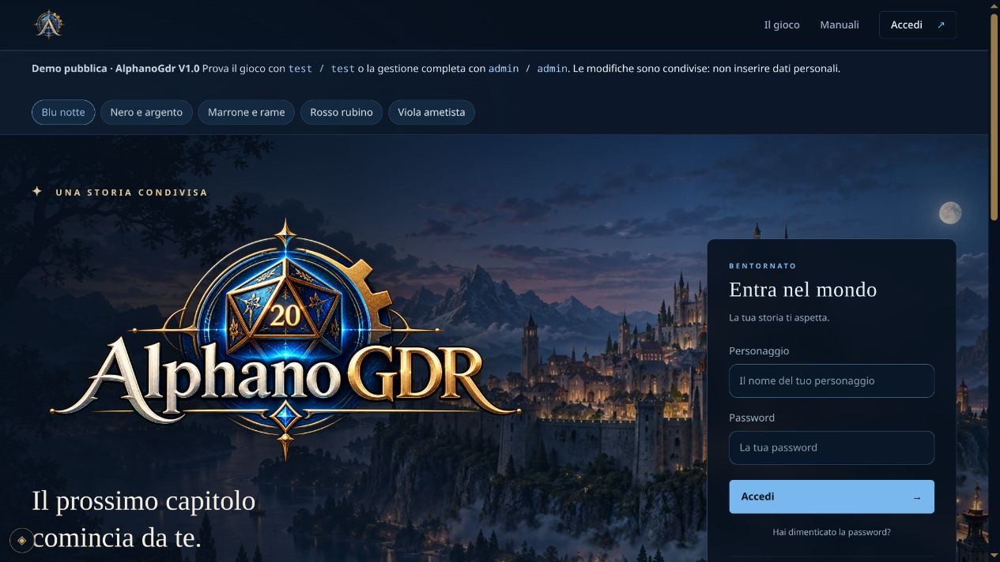
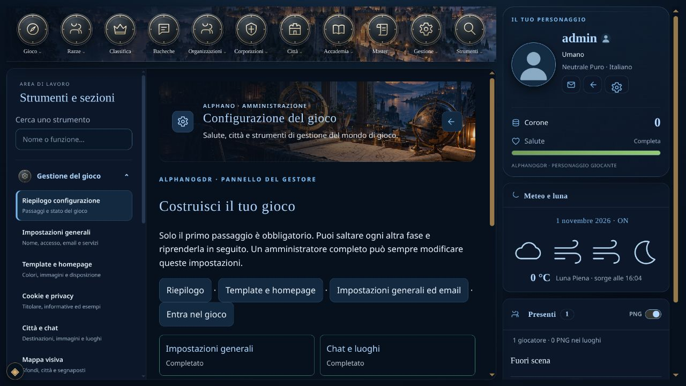
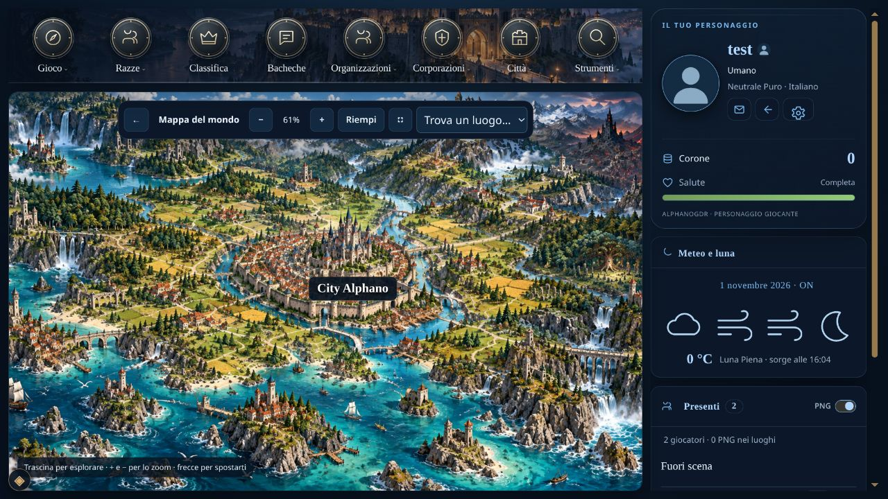
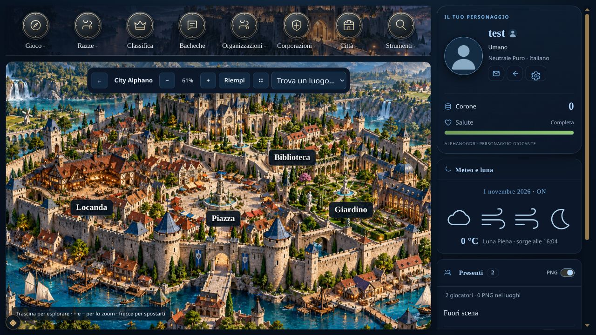
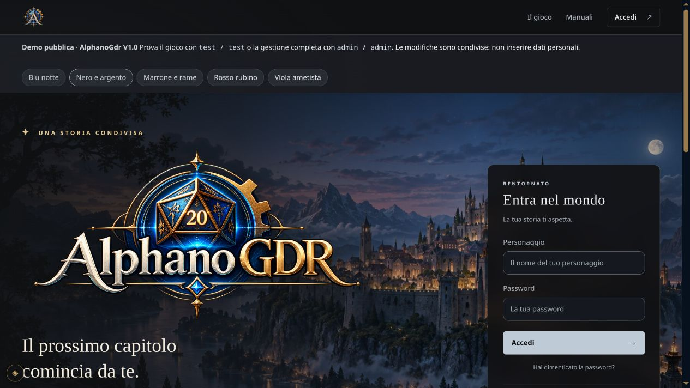
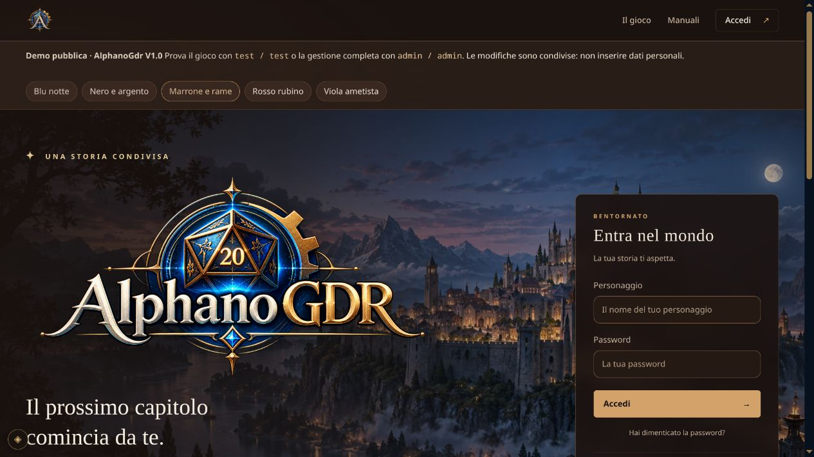
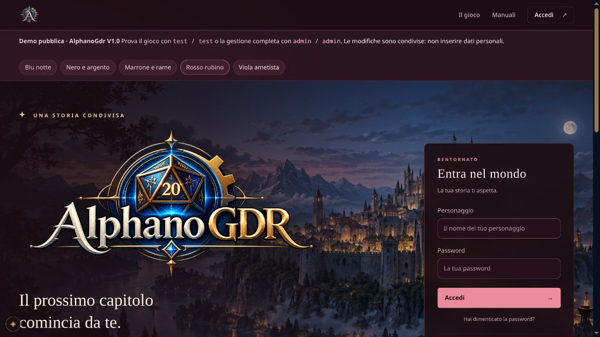
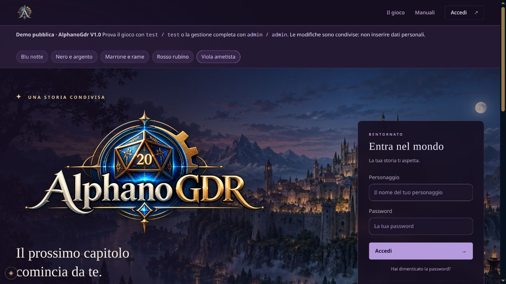

# AlphanoGdr V1.0 — un motore open source per creare il proprio GDR play by chat

Ciao a tutti, sono **Alfano Gaetano** e presento **AlphanoGdr V1.0**, un progetto nato con uno scopo preciso: mettere a disposizione un sistema di GDR play by chat completo e personalizzabile, pensato per funzionare anche su un normale hosting condiviso come AlterVista.

L’obiettivo è permettere di costruire e gestire il proprio gioco **senza scrivere codice**. Occorre saper caricare i file via FTP, avere i dati del database e leggere la documentazione, che attualmente si trova nella repository GitHub. Il codice rimane disponibile a chi vuole estenderlo.

**Repository e documentazione:** https://github.com/Aikanairo/AlphanoGdr

**Demo online:** https://alfanew.altervista.org/?preview=1

**Accessi della demo:**

- Giocatore: **test** — password **test**.
- Gestione completa: **admin** — password **admin**.

La demo è un ambiente pubblico condiviso: l’account admin può modificare realmente le impostazioni. Non inserite dati personali o credenziali reali. Questi account non sono presenti nelle nuove installazioni: ogni gestore sceglie il proprio amministratore.

**Come si installa**

Si scarica il pacchetto completo, lo si scompatta e si caricano tutti i file sul proprio hosting. Aprendo il dominio o `index.php`, se il gioco non è ancora installato, parte la procedura guidata. Dal browser si inseriscono connessione MySQL, nome del gioco, account amministratore ed eventuali impostazioni email.

Le dipendenze PHP sono già incluse: sull’hosting non servono Composer, SSH, Docker, Node.js o competenze di programmazione. Sono richiesti **PHP 8.4 o successivo** e un database MySQL/MariaDB dedicato e vuoto, con le estensioni elencate nella documentazione. L’installazione va nella radice del dominio o sottodominio. La compatibilità è stata provata anche su AlterVista; capacità e prestazioni dipendono comunque dalle risorse del piano e dagli utenti collegati.

**Cosa comprende**

- Chat di gioco con dialoghi, azioni, messaggi riservati, dadi e strumenti dello staff; gestione delle sessioni, turni e registrazioni delle giocate.
- Schede dei personaggi, statistiche, abilità, esperienza, inventario, equipaggiamento, ferite e condizioni.
- Razze ordinarie e speciali, etnie facoltative e trasformazioni con statistiche e messaggi configurabili.
- Città, cariche, cittadinanza ed elezioni facoltative; organizzazioni e corporazioni con gerarchie e strumenti dedicati.
- Economia, tesorerie, trasferimenti, lavori, raccolta, materie prime e strumenti per produzione e commercio. Anche il nome della valuta è personalizzabile.
- Bacheche, manuali, messaggistica, strumenti Master, gestione degli utenti e checklist per completare la configurazione.
- Impostazioni email, recupero password, testi di privacy e cookie, homepage e manuali fissati in evidenza.

I sistemi e i cataloghi si configurano dalla gestione: i moduli facoltativi si possono attivare secondo le esigenze della propria ambientazione. Il supporto IA è **disabilitato inizialmente**; il gioco base funziona senza modelli o servizi di intelligenza artificiale. Un eventuale servizio esterno si configura separatamente.

**La mappa interattiva**

Si può scegliere tra la navigazione a card e una mappa visiva. Il gestore carica lo sfondo del mondo, posiziona le città e sceglie se mostrarne il solo nome oppure un’immagine cerchiata con il nome. Ogni città può avere una propria sottomappa con le chat posizionate.

Zoom, trascinamento e coordinate proporzionali mantengono i segnaposti ancorati al disegno. L’immagine copre il riquadro disponibile e le posizioni si modificano dalla gestione, senza intervenire sul codice.

Il pacchetto di esempio è già selezionato nell’installazione: include **City Alphano**, entrambe le immagini e **Piazza, Locanda, Giardino e Biblioteca** già collegate. Include inoltre Umano, Italiano, cariche Cittadino e Sindaco e 23 materie prime. Si può deselezionare per partire senza dati dimostrativi.

**Cinque palette e layout personalizzabile**

Sono disponibili **Blu notte, Nero e argento, Marrone e rame, Rosso rubino e Viola ametista**. Si possono personalizzare disposizione dei menu, colonna laterale, icone, sfondi e intestazioni delle pagine, oltre a logo, banner e contenuti della homepage. Nella demo i pulsanti in homepage permettono di confrontare i colori senza cambiare il tema globale.

**Codice e documentazione**

AlphanoGdr V1.0 è distribuito con **licenza GNU AGPL-3.0**. Nella repository trovate sorgenti, dipendenze, immagini dimostrative, istruzioni FTP per AlterVista, descrizione dei sistemi e test automatici. Non vengono distribuiti account, conversazioni o database del gioco da cui deriva il motore.

[Gothik.it](https://gothik.it/) è un esempio di GDR attivo con un’ambientazione e una personalizzazione grafica proprie. AlphanoGdr offre la struttura per costruire il vostro mondo, da adattare alle vostre regole.

Mi farà piacere ricevere prove, segnalazioni riproducibili e proposte di miglioramento. Potete aprire una issue nella repository. Per iniziare, leggete il README e la guida di installazione: la documentazione disponibile è attualmente quella su GitHub.
