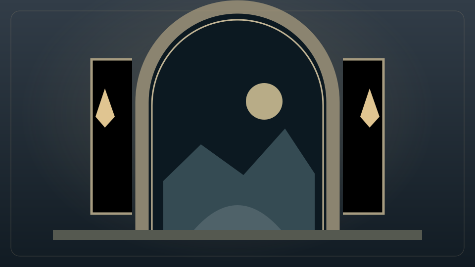

# Immagini predefinite

Il pacchetto comprende 30 illustrazioni SVG originali: 26 icone per menu e sottomenu e quattro copertine per bacheche, manuali, città e chat. Sono distribuite con la licenza del progetto, AGPL-3.0-or-later. Non dipendono da servizi esterni o da un archivio immagini precedente.

Il catalogo completo è in `config/default-art.json`. Ogni voce specifica chiave, percorso e descrizione; i file modificabili sono in `assets/default-*.svg`.

Da **Gestione → Template e homepage** si sceglie ogni menu, sottomenu o pagina e si usa **Immagine del pacchetto**. Si possono anche caricare PNG, JPEG e WebP personali. I caricamenti SVG restano disabilitati: gli SVG inclusi appartengono al codice controllato del pacchetto.

Un menu senza personalizzazione eredita automaticamente l’icona prevista dal tema. Il pulsante di rimozione della personalizzazione ripristina tale icona. Il colore del sito resta configurabile nelle cinque palette e le icone funzionano con navigazione superiore o inferiore.

Le nuove bacheche dispongono sempre di una copertina selezionabile. La selezione vuota usa la copertina della bacheca. Manuali, destinazioni e chat appena creati dispongono delle rispettive copertine senza richiedere caricamenti.

